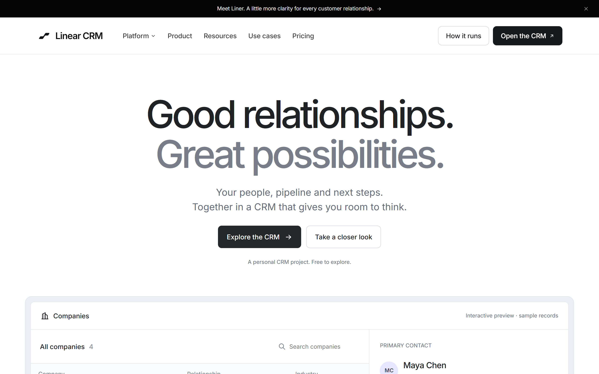
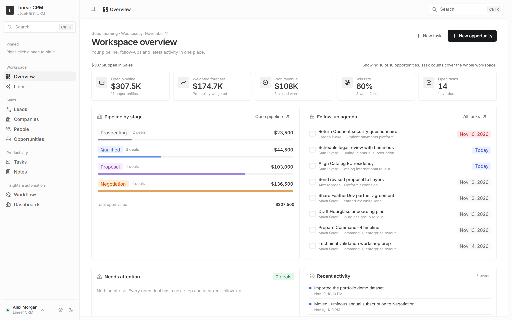
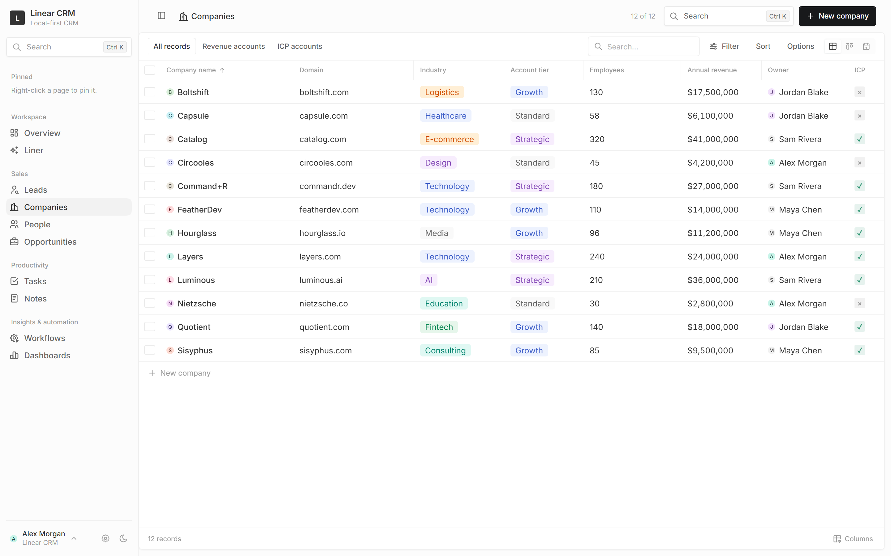
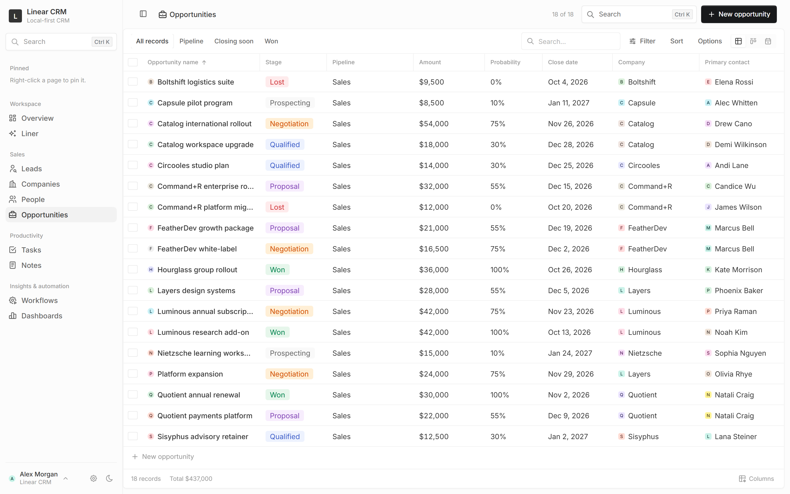
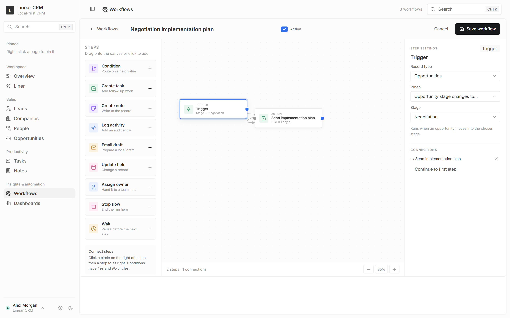
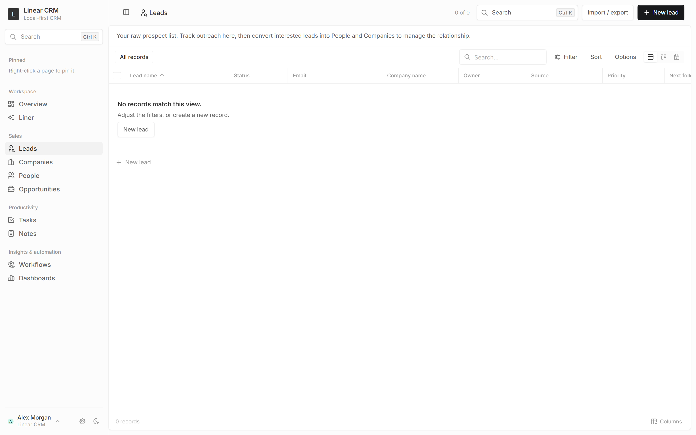
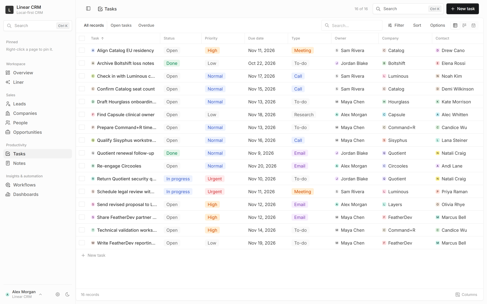
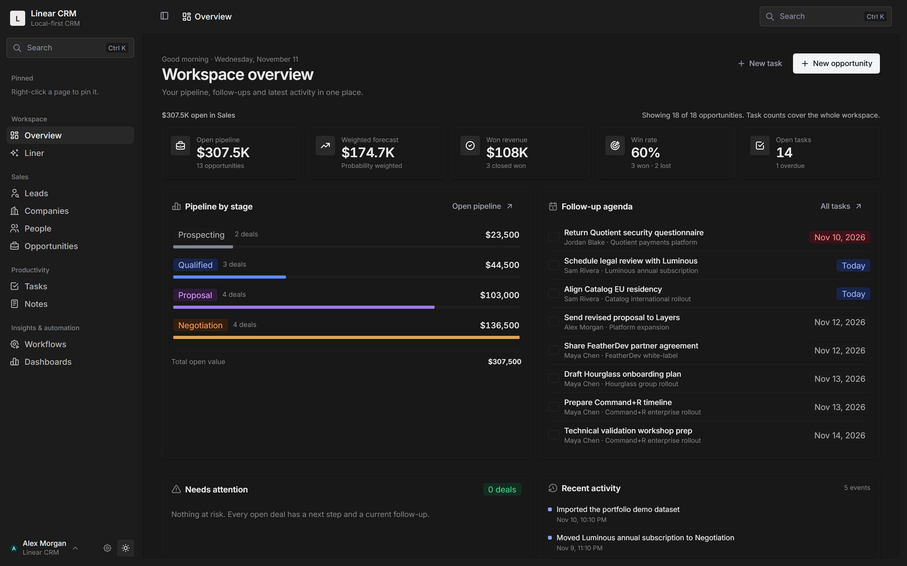

<div align="center">

# Linear CRM

**A modern, browser-local customer relationship management platform with an Attio and Linear-inspired visual design, built with React 19, Emotion, Twenty UI primitives, and esbuild.**

[](LICENSE)
[](https://react.dev)
[](https://esbuild.github.io)
[](https://playwright.dev)
[](#architecture--design-philosophy)
[](#theme-engine--dark-mode)

<br/>

<p align="center">
  <a href="#visual-showcase">Showcase</a> •
  <a href="#core-features">Features</a> •
  <a href="#tools--technologies-used-non-ai">Tech Stack</a> •
  <a href="#backend-integration-blueprint">Backend Integration Guide</a> •
  <a href="#getting-started">Getting Started</a> •
  <a href="#project-structure">Project Structure</a>
</p>

</div>

---

## Visual Showcase

### Editorial Landing Page & Product Overview
> Interactive marketing experience featuring real-time preview components, live filtering, and typography tokens.



---

### Workspace Overview & Sales Analytics
> Executive dashboard with pipeline selectors, weighted forecasting, revenue metrics, stage distributions, and immediate follow-up lists.



---

### Record Table & Deep Detail Drawer
> High-density table view with customizable visible columns, multi-select operations, and side drawer with timeline history, notes, and linked records.



---

### Opportunities Kanban Board
> Multi-pipeline opportunity management with drag-and-drop card movements, probability weightings, and real-time deal stage totals.



---

### Visual Workflow Studio
> Node-based automation canvas supporting triggers, multi-branch conditional gates (Yes/No), wait pauses, field mutations, and task generation.



---

### Lead Outreach & Qualification Pipeline
> Structured outreach lifecycle with qualification stages, source attribution, budget tracking, and relationship-preserving conversion to People & Companies.



---

### Tasks & Recurrence Manager
> Advanced task planner with daily, weekly, and monthly recurrence engine (day-of-month anchoring), completion tracking, and checklist support.



---

### Polished Dark Theme
> High-contrast, accessibility-checked dark mode powered by the Twenty UI design system tokens.



---

## Architecture & Design Philosophy

Linear CRM is an intentional exploration of a **zero-backend, local-first CRM experience**. It combines the architectural rigor of [Twenty](https://github.com/twentyhq/twenty) with the calm, refined visual language of tools like Linear and Attio:

1. **Local-First & Client-Side Persistence**:
   - Zero external server dependencies required out of the box.
   - All workspace state (records, views, pipelines, workflows, custom schema) is persisted in the browser's `localStorage`.
   - Complete multi-workspace isolation via distinct storage keys (`linear-crm.v1`, `linear-crm.workspaces.v1`).
   - Portable JSON snapshot backup and one-click restoration with schema validation.

2. **Calm, High-Density Visual System**:
   - Built on Twenty's open-source frontend primitives (`twenty-ui` and `twenty-front` components) and customized with Emotion.
   - Restrained color palettes, stage dots, icon-led record badges, subtle borders, and smooth transitions.
   - Clean, keyboard-accessible command palette (`Ctrl/Cmd + K`) for instant navigation and record lookup across all entities.

3. **Modular Feature Packs**:
   - Optional business capabilities (Campaigns, Products & Quotes, Invoices, Support Tickets, Projects, and Mailbox Registry) are packaged as toggles.
   - When disabled, they stay completely out of sight without leaving empty navigation headers. When enabled, they inherit the exact same schema, table options, filters, drawers, and workflows as the core objects.

---

## Core Features

### 1. Multi-Page Static Experience
The project includes a 22-page static marketing site sharing one design system, responsive navigation, and live product previews. Every platform menu item resolves to its own page rather than an anchor on a shared page.
- **`index.html` (Home)**: Hero workspace preview, platform stories, Liner, four working mini demos, use cases, pricing boundary, and FAQ.
- **`platform.html`**: The connected system, linking to five platform detail pages.
- **`product.html`**: Product tour with the live table, overview, data model, record moves, and saved views.
- **`resources.html`**: Resources hub for storage, portability, backup, keyboard use, and the FAQ.
- **`customers.html`**: Founder-led sales, studio, and solo-operator scenarios shown with sample records, not invented customers.
- **`pricing.html`**: The transparent \$0 local-first model and the honest list of what a browser-local workspace does not include.
- **`platform-pipeline.html`, `platform-workflows.html`, `platform-liner.html`, `platform-forecast.html`, `platform-context.html`**: One page per platform capability, each with a working demo.
- **`product-data-model.html`, `product-record-moves.html`, `product-saved-views.html`**: Deeper product detail pages.
- **`resources-local-first.html`, `resources-import-export.html`, `resources-backup.html`, `resources-keyboard.html`**: Operational and architectural resources.
- **`privacy.html`, `terms.html`, `accessibility.html`, `cookies.html`**: Legal, accessibility, and browser-storage documents for the personal evaluation project.

The full production plan, including page architecture, section order, copy rules, accessibility, and measurement, lives in [`landingplan.md`](landingplan.md).

### 2. Core CRM Entities & Data Model
- **Companies**: Firmographic tracking (domain, tier, employee headcount, annual revenue, ICP fit, relationship status: Prospect, Active customer, Partner, Former customer, Supplier), associated contacts, and linked opportunities.
- **Contacts (People)**: Direct contact management with email, phone, job title, LinkedIn URLs, company links, and activity logs.
- **Leads & Qualification**: Structured outreach tracking (`Not contacted` → `Contacted` → `Replied` → `Interested` → `Not interested` → `Follow-up`). Includes source attribution, qualification scores, budget sizing, and one-click lead conversion into Contact, Company, and Deal with deduplication matching.
- **Opportunities & Deals**: Deal tracking with amount, probability, close date, owner, linked account, and timeline history.
- **Tasks**: Priority levels, due dates, checklists, linked record associations, completion timestamps, and calendar export.
- **Notes & Activity Timeline**: Rich textual records and immutable audit logs tracking stage moves, field alterations, and user actions.

### 3. Views & Layout Capabilities
- **Interactive Table Views**: Customizable column visibility and order, multi-row bulk selections, column-header sorting, and inline cell editing.
- **Kanban Board**: Drag-and-drop card movements between stages with stage metrics and total deal valuations.
- **Calendar & Agenda Views**: Multi-mode calendar (Month grid, Week board with add-on-day action, and Agenda group-by-day feed). Exports live `.ics` calendar subscriptions with real record titles.
- **Named Saved Views**: Filter combinations, sorting preferences, and column layouts can be named and saved per collection.
- **Record Detail Drawers**: Non-disruptive slide-out drawers featuring editable fields, related record widgets, attachments, notes, and activity timeline feeds.

### 4. Advanced Task Recurrence Engine
- **Repeat Cadence**: Configurable Daily, Weekly, or Monthly repeating rules with optional expiration dates (`Repeat until`).
- **Anchored Day-of-Month**: Monthly occurrences maintain their initial calendar anchor day (e.g. 31st automatically adjusts to month lengths without drift).
- **Idempotent Succession**: Marking a task `Done` instantiates exactly one succeeding occurrence with clean checklists while retaining historical links. Re-opening a completed task never spawns duplicate iterations.

### 5. Workflow Studio & Automation Engine
- **Visual Canvas**: Drag-and-drop node graph builder with SVG Bezier connectors.
- **Triggers**: Record Created, Deal Stage Changed, or Specific Field Value Changed.
- **Conditional Logic**: Multi-condition gates with `ALL` (AND) or `ANY` (OR) branch evaluation routing through dedicated `Yes` and `No` output ports.
- **Action Nodes**: Create Task, Create Note, Log Audit Activity, Generate Email Draft, Mutate Field Value, Reassign Owner, or Stop Execution.
- **Wait Steps**: Pauses downstream execution until a specified delay elapsed. Resumes safely upon next application load or manual run.
- **Simulation & Audit**: Built-in "Dry Run" simulator to preview triggered actions without mutating records, accompanied by expandable execution run logs.

### 6. Data Quality & Smart Record Merging
- **Automated Detection**: Real-time scanning for duplicate People (matched on normalized email addresses) and Companies (matched on root domain or exact name).
- **Conflict Review**: Side-by-side field diff inspection allowing operators to select which attribute values to retain.
- **Relationship Preservation**: All linked tasks, notes, opportunities, files, converted leads, and history items migrate to the retained record. The superseded entity is moved safely to Trash.

### 7. Modular Feature Packs
- **Campaigns & Email Warm-Up**: Multi-step email campaign builder with audience segmenting (Leads or People filtered by owner, source, or status), template merge tags (`{{first_name}}`, `{{company}}`), automated follow-up cadences, and simulated 14-day warm-up sending curves.
- **Products, Quotes & Billing**: Product catalogue (SKUs, categories, unit prices, unit costs, billing cycles). Opportunity Quote builder with line items, quantity, item discounts, real-time margin percentage calculations, and one-click quote-to-amount synchronization.
- **Invoices**: Convert accepted quotes into structured invoices with due dates, payment status tracking, and opportunity links.
- **Support Tickets**: Ticket tracking with priority badges, status boards, category tags, and company/contact ties.
- **Projects**: Project deliverables tracking milestones, budgets, actual spend, completion percentages, and linked sales opportunities.
- **Mailbox Registry**: SMTP credential profiles (Gmail, Google Workspace, Outlook, Custom) with sender health scoring, daily allowance throttling, and connection diagnostics.

### 8. Multi-Workspace & Data Portability
- **Workspace Sandboxes**: Switch between separate client or business workspaces stored under distinct local keys.
- **Snapshot Management**: Create blank or demo-seeded workspaces, duplicate existing setups, rename, or delete workspaces.
- **JSON Backup & Restore**: One-click full workspace export to a standalone `.json` bundle and safe transactional restoration.
- **CSV Import & Export**: Import leads or contacts with CSV templates and export filtered table views.

---

## Tools & Technologies Used (Non-AI)

Linear CRM is built with modern, battle-tested, standard web technologies.

| Category | Technology | Version | Purpose in Linear CRM |
|---|---|---|---|
| **Core Framework** | [React](https://react.dev) | `^19.3.1` | Component model, reactive state management, hooks, and DOM rendering. |
| **DOM Renderer** | [ReactDOM](https://react.dev) | `^19.3.1` | Client-side root rendering and portal drawer mounting. |
| **Component Primitives** | [twenty-ui](https://github.com/twentyhq/twenty) | `^2.54.3` | Upstream design tokens, buttons, tags, avatars, data display, and input controls. |
| **Styling & CSS-in-JS** | [@emotion/react](https://emotion.sh) | `^11.14.0` | Dynamic style evaluation for Twenty UI primitives and theme switching. |
| **Component Styling** | [@emotion/styled](https://emotion.sh) | `^11.14.1` | Scoped styled component definitions matching upstream table architectures. |
| **Iconography** | [@tabler/icons-react](https://tabler.io/icons) | `^3.50.0` | Comprehensive, consistent icon system across navigation, fields, and workflow nodes. |
| **Typography** | [@fontsource/inter](https://fontsource.org/fonts/inter) | `^5.3.0` | Self-hosted Inter font faces (weights 400, 500, 600, 700) for zero-latency, offline font rendering. |
| **Motion & Dynamics** | [framer-motion](https://www.framer.com/motion/) | `^14.10.1` | Smooth accordion transitions, modal entrances, and drawer slide animations. |
| **Timeline Animations** | [gsap](https://greensock.com/gsap/) | `^3.15.1` | Coordinated workflow connector transitions and landing scene animations. |
| **Micro-Interactions** | [animejs](https://animejs.com/) | `^4.5.0` | Metric counter animations and subtle SVG connector pulse effects. |
| **Data Parsing** | [Papa Parse](https://www.papaparse.com/) | `^5.5.3` | In-browser RFC 4180 compliant CSV parsing, auto-typing, and CSV generation for export. |
| **Build Bundler** | [esbuild](https://esbuild.github.io/) | `^0.28.2` | Ultra-fast JavaScript and CSS bundling, minification, tree-shaking, and font asset hashing. |
| **End-to-End Testing** | [Playwright](https://playwright.dev/) | `^1.52.0` | Headless Chrome browser automation, visual regression verification, and E2E test suites. |
| **Unit Testing** | [Node.js Test Runner](https://nodejs.org/api/test.html) | `node --test` | Zero-dependency native unit and domain testing for workflows, commerce, campaigns, and rules. |
| **Static Server** | Python `http.server` | `3.14+` | Zero-configuration local static HTTP serving (`python -m http.server 4817`). |

---

## Backend Integration Blueprint

Linear CRM is architected with a clean separation between UI components (`local/*.jsx`), presentation logic, and state management (`local/store.js`, `local/schema.js`, `local/query.js`). 

If you or your team wish to transform Linear CRM from a browser-local tool into a **multi-tenant, production-grade cloud SaaS**, here is the comprehensive architectural blueprint, database schema, and migration roadmap.

```
┌────────────────────────────────────────────────────────────────────────┐
│                        Linear CRM Client (React 19)                    │
│   TableView │ KanbanBoard │ RecordDrawer │ WorkflowStudio │ Overview   │
└───────────────────────────────────┬────────────────────────────────────┘
                                    │ TanStack Query (REST / GraphQL)
                                    ▼
┌────────────────────────────────────────────────────────────────────────┐
│                       Backend API Layer (Node / Go)                    │
│   Auth / JWT │ Multi-Tenant Middleware │ Record Validation │ Webhooks  │
└───────────┬───────────────────────┬───────────────────────┬────────────┘
            │                       │                       │
            ▼                       ▼                       ▼
┌───────────────────────┐ ┌───────────────────┐ ┌────────────────────────┐
│  PostgreSQL Database  │ │ Redis / Queue     │ │ S3 Storage / Email API │
│  Relational Records   │ │ (BullMQ / Celery) │ │ Cloudflare R2 / S3     │
│  Schema & Custom JSON │ │ Workers & Delays  │ │ Resend / SendGrid      │
└───────────────────────┘ └───────────────────┘ └────────────────────────┘
```

---

### 1. Relational Database Schema (PostgreSQL)

Below is an enterprise-ready PostgreSQL schema covering all objects, relationships, custom fields, and workflow graphs:

```sql
-- 1. Tenants & Workspaces
CREATE TABLE workspaces (
    id UUID PRIMARY KEY DEFAULT gen_random_uuid(),
    name VARCHAR(255) NOT NULL,
    slug VARCHAR(100) UNIQUE NOT NULL,
    settings JSONB DEFAULT '{}'::jsonb, -- stores density, theme defaults, enabled feature packs
    created_at TIMESTAMPTZ DEFAULT NOW(),
    updated_at TIMESTAMPTZ DEFAULT NOW()
);

CREATE TABLE users (
    id UUID PRIMARY KEY DEFAULT gen_random_uuid(),
    email VARCHAR(255) UNIQUE NOT NULL,
    name VARCHAR(255) NOT NULL,
    avatar_url TEXT,
    password_hash TEXT NOT NULL,
    created_at TIMESTAMPTZ DEFAULT NOW()
);

CREATE TABLE workspace_members (
    workspace_id UUID REFERENCES workspaces(id) ON DELETE CASCADE,
    user_id UUID REFERENCES users(id) ON DELETE CASCADE,
    role VARCHAR(50) DEFAULT 'member', -- 'owner', 'admin', 'member', 'viewer'
    PRIMARY KEY (workspace_id, user_id)
);

-- 2. Companies & Contacts
CREATE TABLE companies (
    id UUID PRIMARY KEY DEFAULT gen_random_uuid(),
    workspace_id UUID NOT NULL REFERENCES workspaces(id) ON DELETE CASCADE,
    name VARCHAR(255) NOT NULL,
    domain VARCHAR(255),
    industry VARCHAR(100),
    tier VARCHAR(50),
    relationship_status VARCHAR(50) DEFAULT 'prospect',
    annual_revenue NUMERIC(15, 2),
    employee_count INT,
    owner_id UUID REFERENCES users(id) ON DELETE SET NULL,
    custom_fields JSONB DEFAULT '{}'::jsonb,
    is_deleted BOOLEAN DEFAULT FALSE,
    created_at TIMESTAMPTZ DEFAULT NOW(),
    updated_at TIMESTAMPTZ DEFAULT NOW()
);
CREATE INDEX idx_companies_workspace ON companies(workspace_id) WHERE NOT is_deleted;
CREATE INDEX idx_companies_domain ON companies(workspace_id, domain);

CREATE TABLE contacts (
    id UUID PRIMARY KEY DEFAULT gen_random_uuid(),
    workspace_id UUID NOT NULL REFERENCES workspaces(id) ON DELETE CASCADE,
    company_id UUID REFERENCES companies(id) ON DELETE SET NULL,
    first_name VARCHAR(100) NOT NULL,
    last_name VARCHAR(100),
    email VARCHAR(255),
    phone VARCHAR(50),
    job_title VARCHAR(150),
    linkedin_url TEXT,
    owner_id UUID REFERENCES users(id) ON DELETE SET NULL,
    custom_fields JSONB DEFAULT '{}'::jsonb,
    is_deleted BOOLEAN DEFAULT FALSE,
    created_at TIMESTAMPTZ DEFAULT NOW(),
    updated_at TIMESTAMPTZ DEFAULT NOW()
);
CREATE INDEX idx_contacts_workspace ON contacts(workspace_id) WHERE NOT is_deleted;
CREATE INDEX idx_contacts_email ON contacts(workspace_id, email);

-- 3. Leads & Qualification
CREATE TABLE leads (
    id UUID PRIMARY KEY DEFAULT gen_random_uuid(),
    workspace_id UUID NOT NULL REFERENCES workspaces(id) ON DELETE CASCADE,
    first_name VARCHAR(100) NOT NULL,
    last_name VARCHAR(100),
    email VARCHAR(255),
    company_name VARCHAR(255),
    status VARCHAR(50) DEFAULT 'not_contacted', -- 'not_contacted', 'contacted', 'replied', 'interested', 'not_interested', 'follow_up'
    priority VARCHAR(20) DEFAULT 'medium',
    source VARCHAR(100),
    budget NUMERIC(15, 2),
    business_needs TEXT,
    converted_contact_id UUID REFERENCES contacts(id) ON DELETE SET NULL,
    converted_company_id UUID REFERENCES companies(id) ON DELETE SET NULL,
    owner_id UUID REFERENCES users(id) ON DELETE SET NULL,
    is_deleted BOOLEAN DEFAULT FALSE,
    created_at TIMESTAMPTZ DEFAULT NOW(),
    updated_at TIMESTAMPTZ DEFAULT NOW()
);

-- 4. Pipelines, Stages & Opportunities
CREATE TABLE pipelines (
    id UUID PRIMARY KEY DEFAULT gen_random_uuid(),
    workspace_id UUID NOT NULL REFERENCES workspaces(id) ON DELETE CASCADE,
    name VARCHAR(100) NOT NULL,
    is_default BOOLEAN DEFAULT FALSE,
    created_at TIMESTAMPTZ DEFAULT NOW()
);

CREATE TABLE pipeline_stages (
    id UUID PRIMARY KEY DEFAULT gen_random_uuid(),
    pipeline_id UUID NOT NULL REFERENCES pipelines(id) ON DELETE CASCADE,
    name VARCHAR(100) NOT NULL,
    position INT NOT NULL,
    probability INT NOT NULL DEFAULT 20, -- 0 to 100 percentage
    created_at TIMESTAMPTZ DEFAULT NOW()
);

CREATE TABLE opportunities (
    id UUID PRIMARY KEY DEFAULT gen_random_uuid(),
    workspace_id UUID NOT NULL REFERENCES workspaces(id) ON DELETE CASCADE,
    pipeline_id UUID NOT NULL REFERENCES pipelines(id) ON DELETE RESTRICT,
    stage_id UUID NOT NULL REFERENCES pipeline_stages(id) ON DELETE RESTRICT,
    company_id UUID REFERENCES companies(id) ON DELETE SET NULL,
    contact_id UUID REFERENCES contacts(id) ON DELETE SET NULL,
    name VARCHAR(255) NOT NULL,
    amount NUMERIC(15, 2) DEFAULT 0,
    probability INT,
    expected_close_date DATE,
    owner_id UUID REFERENCES users(id) ON DELETE SET NULL,
    quote_data JSONB DEFAULT '{}'::jsonb, -- line items, discounts, margin totals
    is_deleted BOOLEAN DEFAULT FALSE,
    created_at TIMESTAMPTZ DEFAULT NOW(),
    updated_at TIMESTAMPTZ DEFAULT NOW()
);

-- 5. Tasks, Recurrence & Notes
CREATE TABLE tasks (
    id UUID PRIMARY KEY DEFAULT gen_random_uuid(),
    workspace_id UUID NOT NULL REFERENCES workspaces(id) ON DELETE CASCADE,
    title VARCHAR(255) NOT NULL,
    description TEXT,
    status VARCHAR(50) DEFAULT 'open', -- 'open', 'in_progress', 'waiting', 'blocked', 'done', 'cancelled'
    priority VARCHAR(20) DEFAULT 'medium',
    due_date TIMESTAMPTZ,
    completed_at TIMESTAMPTZ,
    
    -- Recurrence Configuration
    repeat_interval VARCHAR(20), -- 'daily', 'weekly', 'monthly', NULL
    repeat_until TIMESTAMPTZ,
    repeat_anchor_day INT, -- anchor day for monthly
    parent_recurring_task_id UUID REFERENCES tasks(id) ON DELETE SET NULL,
    
    -- Dynamic Polymorphic Associations
    linked_company_id UUID REFERENCES companies(id) ON DELETE SET NULL,
    linked_contact_id UUID REFERENCES contacts(id) ON DELETE SET NULL,
    linked_opportunity_id UUID REFERENCES opportunities(id) ON DELETE SET NULL,
    
    checklists JSONB DEFAULT '[]'::jsonb, -- array of { id, text, done }
    owner_id UUID REFERENCES users(id) ON DELETE SET NULL,
    is_deleted BOOLEAN DEFAULT FALSE,
    created_at TIMESTAMPTZ DEFAULT NOW(),
    updated_at TIMESTAMPTZ DEFAULT NOW()
);

CREATE TABLE notes (
    id UUID PRIMARY KEY DEFAULT gen_random_uuid(),
    workspace_id UUID NOT NULL REFERENCES workspaces(id) ON DELETE CASCADE,
    content TEXT NOT NULL,
    linked_company_id UUID REFERENCES companies(id) ON DELETE CASCADE,
    linked_contact_id UUID REFERENCES contacts(id) ON DELETE CASCADE,
    linked_opportunity_id UUID REFERENCES opportunities(id) ON DELETE CASCADE,
    created_by UUID REFERENCES users(id) ON DELETE SET NULL,
    created_at TIMESTAMPTZ DEFAULT NOW()
);

-- 6. Workflows & Visual Graph State
CREATE TABLE workflows (
    id UUID PRIMARY KEY DEFAULT gen_random_uuid(),
    workspace_id UUID NOT NULL REFERENCES workspaces(id) ON DELETE CASCADE,
    name VARCHAR(255) NOT NULL,
    enabled BOOLEAN DEFAULT TRUE,
    trigger JSONB NOT NULL, -- { object: "deals", event: "stage_changed", value: "Proposal" }
    nodes JSONB NOT NULL,   -- graph nodes: coordinates, step definitions
    edges JSONB NOT NULL,   -- graph connectors: source, target, sourceHandle ('yes'/'no')
    created_at TIMESTAMPTZ DEFAULT NOW(),
    updated_at TIMESTAMPTZ DEFAULT NOW()
);

CREATE TABLE workflow_runs (
    id UUID PRIMARY KEY DEFAULT gen_random_uuid(),
    workflow_id UUID NOT NULL REFERENCES workflows(id) ON DELETE CASCADE,
    workspace_id UUID NOT NULL REFERENCES workspaces(id) ON DELETE CASCADE,
    target_record_type VARCHAR(50) NOT NULL,
    target_record_id UUID NOT NULL,
    status VARCHAR(50) DEFAULT 'completed', -- 'queued', 'running', 'completed', 'failed'
    steps_log JSONB DEFAULT '[]'::jsonb,
    error_message TEXT,
    created_at TIMESTAMPTZ DEFAULT NOW()
);

CREATE TABLE workflow_schedules (
    id UUID PRIMARY KEY DEFAULT gen_random_uuid(),
    workflow_id UUID NOT NULL REFERENCES workflows(id) ON DELETE CASCADE,
    workspace_id UUID NOT NULL REFERENCES workspaces(id) ON DELETE CASCADE,
    step_id VARCHAR(100) NOT NULL,
    target_record_type VARCHAR(50) NOT NULL,
    target_record_id UUID NOT NULL,
    execute_at TIMESTAMPTZ NOT NULL,
    status VARCHAR(20) DEFAULT 'pending',
    created_at TIMESTAMPTZ DEFAULT NOW()
);
CREATE INDEX idx_workflow_schedules_due ON workflow_schedules(execute_at) WHERE status = 'pending';
```

---

### 2. API Endpoints Specification

An idiomatic REST or GraphQL API for this schema:

| Resource | Method | Endpoint | Purpose |
|---|---|---|---|
| **Auth** | `POST` | `/api/v1/auth/register`, `/api/v1/auth/login` | Session issuance / JWT cookie generation. |
| **Workspaces** | `GET`, `POST` | `/api/v1/workspaces` | Workspace switching and tenant configuration. |
| **Companies** | `GET`, `POST` | `/api/v1/companies` | List with cursor pagination, filtering (`?tier=A`), create. |
| **Companies** | `PATCH`, `DELETE`| `/api/v1/companies/:id` | Inline update and soft-delete to Trash. |
| **Contacts** | `GET`, `POST` | `/api/v1/contacts` | Contact management with company link hydration. |
| **Leads** | `POST` | `/api/v1/leads/:id/convert` | Atomic lead conversion into Contact, Company, and Deal. |
| **Deals** | `GET` | `/api/v1/opportunities?pipeline_id=...` | Board and table view query with aggregations. |
| **Deals** | `PATCH` | `/api/v1/opportunities/:id/stage` | Kanban drag-and-drop stage updates with workflow event triggers. |
| **Tasks** | `POST` | `/api/v1/tasks/:id/complete` | Complete task and compute next recurring occurrence. |
| **Workflows** | `POST` | `/api/v1/workflows/:id/run` | Manual run or dry-run execution on a given record. |
| **Data Quality**| `POST` | `/api/v1/data-quality/merge` | Merge two records and re-link associated dependencies. |
| **Search** | `GET` | `/api/v1/search?q=...` | Full-text search across all entity fields for `Ctrl+K`. |

---

### 3. Step-by-Step Frontend Migration Plan

To adapt the existing frontend from `local/store.js` to a remote backend:

1. **Introduce a Data Client Layer (TanStack Query)**:
   - Install `@tanstack/react-query`:
     ```bash
     npm install @tanstack/react-query
     ```
   - In `local/store.js`, wrap fetch operations in query hooks:
     ```javascript
     export function useCompanies(filters) {
       return useQuery({
         queryKey: ['companies', filters],
         queryFn: () => fetch(`/api/v1/companies?${new URLSearchParams(filters)}`).then(r => r.json()),
       });
     }
     ```

2. **Optimistic UI Updates for Instant Response**:
   - For Kanban card drops and table cell edits, apply TanStack Query's `onMutate` optimistic updates so the UI remains as instant and fluid as the current `localStorage` edition.

3. **Background Job Queue (BullMQ / Redis)**:
   - The frontend's client-side recurrence calculation (`local/task-activity.mjs`) and workflow wait execution (`local/workflow-engine.mjs`) should move to backend worker queues:
     - **Recurring Task Generator**: A 1-minute cron worker evaluates due dates and spawns next occurrences.
     - **Workflow Wait Processor**: When a workflow hits a `Wait` node, an entry is added to `workflow_schedules` or a delayed BullMQ job is enqueued (`{ delay: waitHours * 3600000 }`).
     - **Campaign Batch Sender**: Scheduled workers dispatch queued email batches within the mailbox's daily warm-up quota.

4. **Transactional Email & Attachment Storage**:
   - **Email Dispatch**: Integrate [Resend](https://resend.com) or [SendGrid](https://sendgrid.com) to execute actual email sends from Campaign Studio.
   - **Asset Uploads**: Replace file data strings with pre-signed upload URLs to Amazon S3 or Cloudflare R2 (`PUT /api/v1/uploads/presigned`).

---

## Getting Started

### Prerequisites
- **Node.js**: Version `20.x` or higher
- **Python**: Version `3.x` (for local static HTTP serving)

### Installation

```bash
# Clone the repository
git clone https://github.com/rayyanallii/linearcrm.git
cd linearcrm

# Install project dependencies
npm ci --legacy-peer-deps
```

### Build & Run Locally

```bash
# 1. Bundle the frontend with esbuild
npm run build

# 2. Start the local development server (binds to http://127.0.0.1:4817)
npm run serve
```

Once running, navigate to:
- **Marketing & Editorial Site**: [http://127.0.0.1:4817/](http://127.0.0.1:4817/)
- **Interactive CRM Workspace**: [http://127.0.0.1:4817/app.html](http://127.0.0.1:4817/app.html)

---

## Test Suite & Verification

Linear CRM comes with comprehensive unit and Playwright end-to-end test coverage.

```bash
# Run workflow graph & condition rule checks
npm run test:workflows

# Run quote line items, discounts, margin, and commerce calculations
npm run test:commerce

# Run campaign audience segmentation & email warm-up ramp tests
npm run test:campaigns

# Run lead conversion & deduplication unit tests
npm run test:leads

# Run duplicate detection & merge verification
npm run test:duplicates

# Run pipeline settings & forecasting verification
npm run test:pipelines

# Run task recurrence engine & activity tracking tests
npm run test:activity

# Run the complete Playwright E2E browser walkthrough (requires server running)
npm run test:e2e
```

To take fresh high-resolution screenshots for documentation or presentations:
```bash
node scripts/take-screenshots.mjs
```

---

## Project Structure

```
LinearCRM/
├── index.html                    # Marketing home page
├── platform.html                 # Platform overview
├── product.html                  # Product tour
├── resources.html                # Resources hub
├── customers.html                # Use cases
├── pricing.html                  # Pricing and local-first boundaries
├── platform-*.html               # Pipeline, workflows, Liner, forecast, context
├── product-*.html                # Data model, record moves, saved views
├── resources-*.html              # Local-first, import/export, backup, keyboard
├── landingplan.md                # Production landing page plan
├── app.html                      # Single-page CRM workspace entry point
├── build.mjs                     # esbuild build pipeline for JS, CSS & assets
├── package.json                  # Dependencies, scripts, and package metadata
│
├── local/                        # React 19 Workspace Source
│   ├── Workspace.jsx             # Main CRM shell, router, sidebar & command menu
│   ├── Landing.jsx               # Marketing entry point and route selection
│   ├── site/                     # Marketing design system, pages and live demos
│   ├── Overview.jsx              # Executive dashboard & sales metrics
│   ├── TableView.jsx             # High-density data table & column manager
│   ├── BoardView.jsx             # Kanban drag-and-drop opportunity board
│   ├── RecordPage.jsx            # Detail drawer, tabs, fields & relations
│   ├── Workflows.jsx             # Workflows list & management
│   ├── WorkflowStudio.jsx        # Visual node-graph automation canvas
│   ├── workflow-engine.mjs       # Graph traversal, conditions & execution engine
│   ├── workflow-templates.mjs    # Pre-built automation templates
│   ├── LeadConversion.jsx        # Lead qualification & conversion modal
│   ├── DataQuality.jsx           # Duplicate scanning & merge review UI
│   ├── duplicates.js             # Email & domain deduplication algorithms
│   ├── QuoteBuilder.jsx          # Product catalogue & quote calculator
│   ├── commerce.mjs              # Line item pricing, discount & margin math
│   ├── CampaignStudio.jsx        # Campaign builder & audience segmenting
│   ├── campaigns.mjs             # Campaign send planner & warm-up curves
│   ├── Mailboxes.jsx             # SMTP profiles & sender health diagnostics
│   ├── RecordCalendar.jsx        # Month, Week, and Agenda calendars
│   ├── task-activity.mjs         # Day-anchored task recurrence engine
│   ├── store.js                  # LocalStorage data persistence layer
│   ├── schema.js                 # Dynamic record schema & custom fields
│   └── upstream/                 # Adapted Twenty UI primitives (licensed under AGPL-3.0)
│
├── public/                       # Compiled production artifacts
│   ├── linear.js                 # Bundled CRM application
│   ├── linear.css                # Bundled CRM styles
│   ├── landing.js                # Bundled marketing site code
│   ├── landing.css               # Bundled marketing site styles
│   ├── brand/                    # Brand marks and app icons
│   └── assets/                   # Hashed Inter font files
│
├── docs/                         # Documentation & Visual Assets
│   ├── images/                   # High-resolution screenshots for README
│   ├── workflows-design.md       # Graph execution engine design specification
│   └── phase-1-execution.md      # Development milestone logs
│
└── scripts/                      # Test Harnesses & E2E Suites
    ├── e2e.mjs                   # Comprehensive Playwright E2E walkthrough
    ├── workflow-canvas.e2e.mjs   # Workflow visual canvas interaction tests
    ├── lead-conversion.test.mjs  # Unit tests for lead conversion
    ├── commerce.test.mjs         # Unit tests for quotes and discounts
    ├── campaigns.test.mjs        # Unit tests for warm-up and audience filters
    └── take-screenshots.mjs      # Automated screenshot capture script
```

---

## License & Upstream Attribution

- The record-table row, header cell, data cell, record card, navigation group, navigation icon, and page container in `local/upstream/` are adapted from [Twenty](https://github.com/twentyhq/twenty) (`twenty-front`), licensed under the **GNU Affero General Public License v3.0 (AGPL-3.0)**. See [`local/upstream/LICENSE`](local/upstream/LICENSE) for upstream terms.
- Linear CRM is distributed under the **GNU Affero General Public License v3.0 (AGPL-3.0)**.
